# Personalized Affective Perception via Continual Learning in Human-Agent Negotiation

> **Keywords**: Human-Agent Interaction, Automated Negotiation, Affective Computing, Continual Learning, Facial Expression Recognition, Personalization

This repository contains the official supplementary material for the paper *Personalized Affective Perception via Continual Learning in Human-Agent Negotiation*. It includes the complete source code, the anonymized experimental dataset (N=66), and a reproducibility suite.

---

## 1. System Architecture

The figure below illustrates the complete system architecture, showing the integration of the **CLIFER** module with the negotiation agent:

<p align="center">
  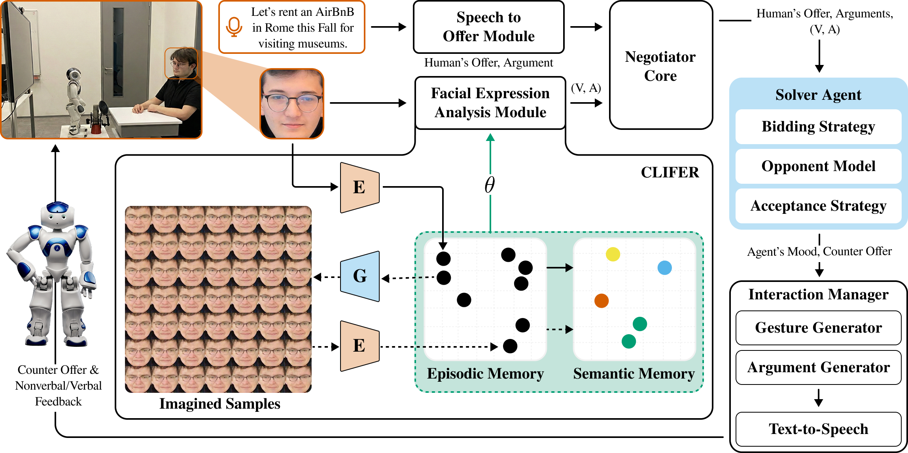
</p>

**Key Components:**

- **Speech to Offer Module**: Converts human verbal offers to structured bids
- **Facial Expression Analysis Module**: Real-time affect perception via CLIFER
- **Negotiator Core**: Manages protocol state, utility space, and offer history
- **Solver Agent**: Decision-making logic (Bidding Strategy, Opponent Model, Acceptance Strategy)
- **CLIFER**: Dual-memory architecture with Episodic (GDM-E) and Semantic (GDM-S) memories

---

## 2. Abstract

Self-interested intelligent agents that negotiate with humans should interpret nonverbal expressions and adapt their behavior accordingly. However, generic facial-affect models degrade across individuals and contexts, creating a generalization gap. We present an agent that incorporates **Continual Learning (CL) with Imagination for Facial Expression Recognition (CLIFER)** to personalize its valence-arousal perception model in real time. By embedding this dynamic perception directly into a utility-based negotiation strategy, the agent effectively balances plasticity and stability. Our system combines CLIFER with an asynchronous architecture that updates the model in the background while participants interact in real time. It modulates negotiation strategy using differential affective feedback. In a counterbalanced within-subject study in which participants negotiated with a humanoid robot, the CL-enabled agent achieved significantly higher individual utility than the generic CNN-based (FaceChannel) baseline, while maintaining equivalent joint optimality. Continual adaptation produced a significant improvement in the agent's sensitivity to participants' arousal levels. This personalized perception motivates a highly collaborative dynamic, leading participants to significantly increase their concession rate while strictly bounding uncoordinated moves. Specifically, mediation analysis showed these benefits operate through parallel, dual-process mechanisms rather than a serial causal chain. The agent uses affective feedback to independently optimize its utility, while its functionally coherent affective signaling simultaneously promotes mutual cooperation.

---

## 3. Prerequisites

### Hardware Requirements

- **Camera**: Any USB webcam (for facial expression capture)
- **Robot** (optional): NAO, Pepper, or QT robot; Virtual Avatar also supported via Negotiator framework
- **GPU** (recommended): NVIDIA GPU with CUDA support for faster inference

### Software Requirements

- **Python**: 3.8+
- **TensorFlow**: 1.15 or 2.x (for CAAE model)
- **CUDA**: 11.x (optional, for GPU acceleration)
- **cuDNN**: 8.x (optional, for GPU acceleration)

### Trained Models

The pre-trained CAAE (Conditional Adversarial Auto-Encoder) model for imagination is included in `src_code/solver_cl_agent/FaceChannel/CLModel/checkpoint/`.

For the original CLIFER trained models, see the [CLIFER Repository](https://github.com/nchuramani/CLIFER).

---

## 3.5. Verification & Replication Script

We provide a Python script (`verify_all_results.py`) to replicate the paper's findings. The script automatically merges the raw logs, computes the paired t-tests, fits the mixed-effects regression models, runs the within-subject mediation analysis, and prints a comparison table against the values reported in the paper.

### Installation
Install all scientific and statistical dependencies in a virtual environment:
```bash
pip install -r requirements.txt
```

### Run Replication Script
Execute the replication pipeline from the root directory:
```bash
python3 verify_all_results.py
```
This script dynamically:
1. Re-merges the uncorrupted turns using `statistical_analysis/code/merge_session_logs.py`.
2. Computes and checks all paired utility and concession statistics.
3. Fits the mixed-effects regression models.
4. Generates a colorized terminal comparison table comparing replicated metrics directly against the targets.
5. Saves the statistical replication report to `statistical_analysis/reports/verification_results_summary.txt`.

---

## 4. Repository Organization

```
├── README.md               # This file
├── LICENSE                 # MIT License
├── requirements.txt        # Python dependencies
├── verify_all_results.py   # [Replication] Academic replication CLI suite
├── assets/                 # Figures for documentation
├── final_dataset/          # [DATA] Anonymized experimental results (N=66)
│   ├── experiment_subject_data.csv  # Subject-level metrics
│   ├── experiment_round_data.csv    # Round-level affect data
│   └── README.md
├── src_code/               # [CODE] Implementation of the CL Agent
│   ├── ARCHITECTURE.md     # Paper-to-code mapping
│   ├── README_CODE.md
│   └── solver_cl_agent/
│       ├── FaceChannel/    # CLIFER Module (Continual Learning)
│       ├── HATN/           # Negotiator Core (Protocol)
│       └── Agent/          # Solver Agent (Decision Logic)
└── statistical_analysis/   # [ANALYSIS] Mixed-effects models
    ├── code/               # Python scripts
    └── reports/            # PDF reports
```

---

## 5. Proposed Method: Implementation Details

The provided source code implements the CLIFER module and the Solver Agent to address the plasticity-stability dilemma during real-time negotiation. It includes the following components:

### 5.1. Generative Replay (CLIFER Module)

Located in `src_code/solver_cl_agent/FaceChannel/CLModel/`:

- **Episodic Memory (GDM-E)**: Dynamic buffer for rapid adaptation to user-specific frames.
- **Semantic Memory (GDM-S)**: CAAE-based long-term memory for stable feature retention.
- **Loss Function**: To prevent catastrophic forgetting, we optimize:

    ```
    L_total = L_real(F_r) + λ · L_imagined(F_gen)
    ```

### 5.2. Differential Affective Feedback (P_E)

Located in `src_code/solver_cl_agent/Agent/Solver_Agent/Solver_Agent.py` (Lines 467-503):

The agent calculates a **Differential Affective Feedback** signal ($P_E$) that decomposes emotional shift into directional and intensity components:

```
# Session-Adaptive Normalization
Ẽ_t = (E_t - μ_t) / (σ_t + ε)

# Directional Sign (handles "Anger Paradox")
P_sign = sgn(ΔV + α · ΔA)

# Rotation Component (qualitative change)
P_rot = atan2(δ_det, δ_dot)   # normalized by π

# Radial Component (intensity change)  
P_rad = |‖Ẽ_t‖ - ‖Ẽ_{t-1}‖|  # normalized by √2

# Final Signal
P_E = P_sign × min(√(P_rot² + P_rad²), 1.0)
```

where `δ_det = det(Ẽ_{t-1}, Ẽ_t)` and `δ_dot = Ẽ_{t-1} · Ẽ_t`.

<p align="center">
  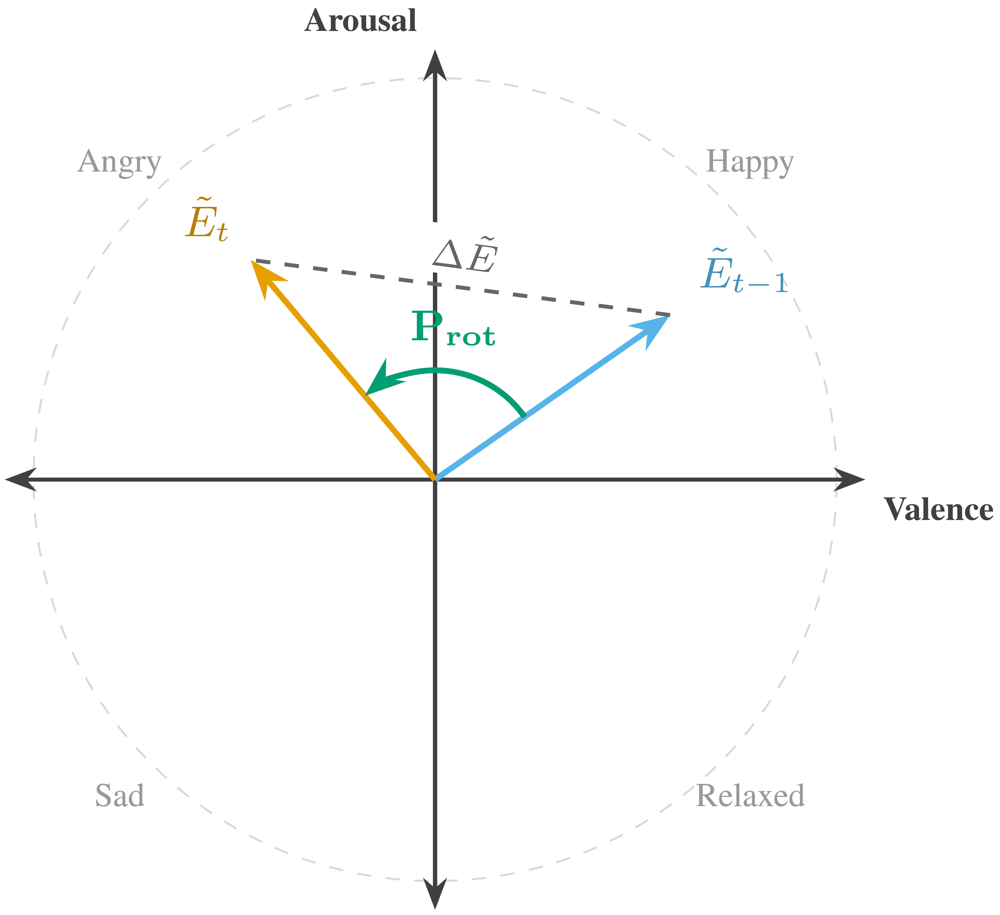
</p>

### 5.3. Asynchronous Architecture

Located in `src_code/solver_cl_agent/main.py`:

- **Thread 1 (Interaction)**: Captures frames and bids using the *frozen* model (θ_curr).
- **Thread 2 (Learning)**: Asynchronously updates weights (θ_train) using Generative Replay and syncs them back.

---

## 6. Experimental Dataset

The folder `final_dataset/` contains the anonymized data from our within-subjects study (N=66, representing 132 negotiation sessions).

We assessed statistical power ($N=66$ paired samples provides power $\ge 0.80$ to detect an effect size of $d=0.35$). We checked normality using Shapiro-Wilk tests and analyzed the nested round-level data using Linear Mixed-Effects Models (LMMs) with random intercepts per subject to account for within-subject correlations.


## 7. Key Results Summary

### Experimental Procedure

<p align="center">
  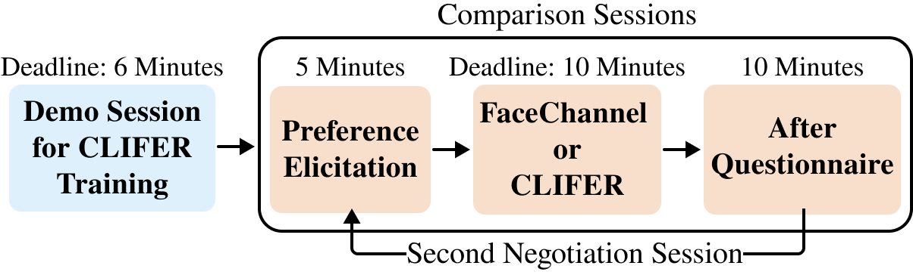
</p>

Each participant negotiated twice with the NAO robot "Solver" in a counterbalanced within-subjects design:

- **Demo Session**: Grocery domain (calibration phase for CL initialization)
- **Session 1 & 2**: Holiday domain with FaceChannel (FC) or CLIFER (CL) conditions

<p align="center">
  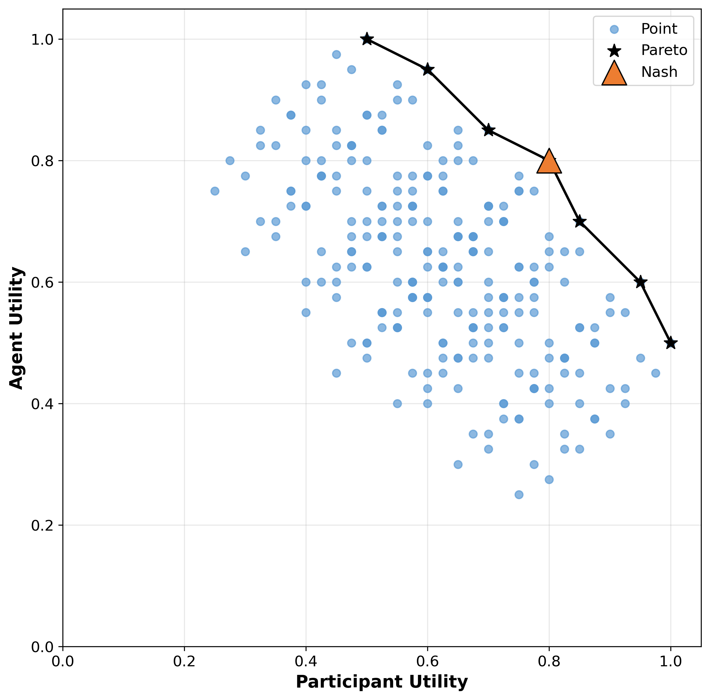
</p>

### 7.1. Affective Perception (RQ1)

**Subject-Level Affect Signal (Paper Fig. 6a):** CL significantly boosts arousal sensitivity (d=0.69) at the subject level.

<p align="center">
  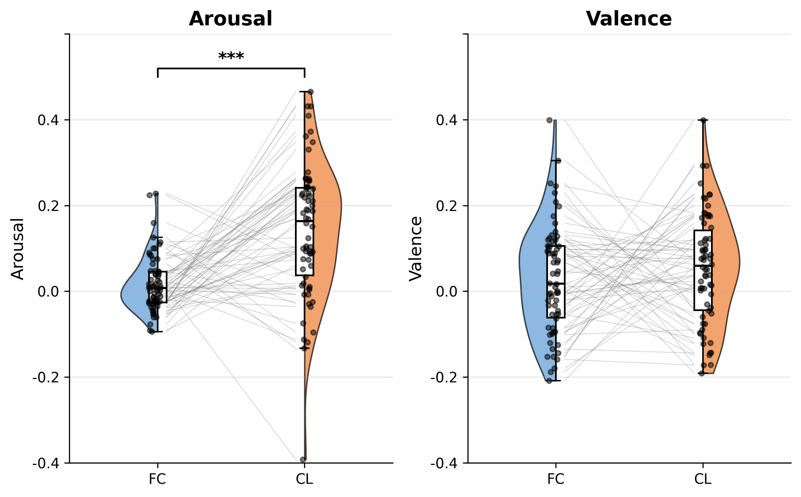
</p>

**Round-Level Robustness (Paper Fig. 6b):** Effect confirmed at round level (d=0.88).

<p align="center">
  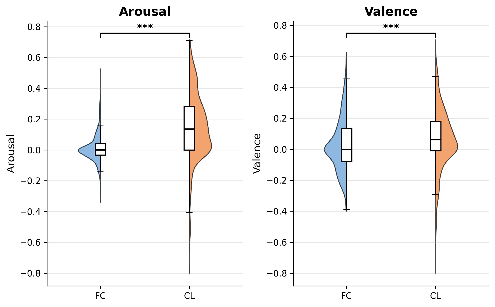
</p>

<div align="center">

| Metric | FC | CL | *p* | *d* |
|--------|----|----|-----|-----|
| **Arousal (Round)** | 0.01 ± 0.09 | **0.15 ± 0.22** | **<0.001** | **0.88** |
| Valence (Round) | 0.03 ± 0.18 | 0.07 ± 0.20 | <0.001 | 0.18 |
| **Arousal (Subject)** | 0.02 ± 0.07 | **0.14 ± 0.16** | **<0.001** | **0.69** |
| Valence (Subject) | 0.03 ± 0.13 | 0.05 ± 0.13 | 0.317 | 0.13 |

</div>

- **Arousal Sensitivity**: The CL condition significantly improved arousal sensitivity compared to the baseline ($d_z=0.69$ at the subject level), with **75.8%** of the participants showing higher sensitivity.

<p align="center">
  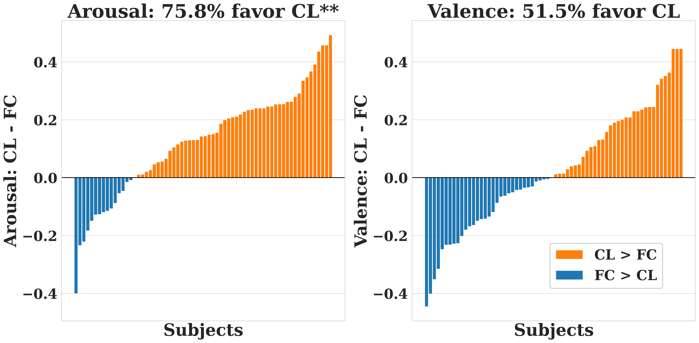
</p>

- **Temporal Stability (Paper Fig. 6d)**: CL maintains superior arousal sensitivity consistently across all negotiation rounds. CL's advantage grows with adaptation: Δ=0.05 (early) → Δ=0.19 (mid) → Δ=0.15 (late).

<p align="center">
  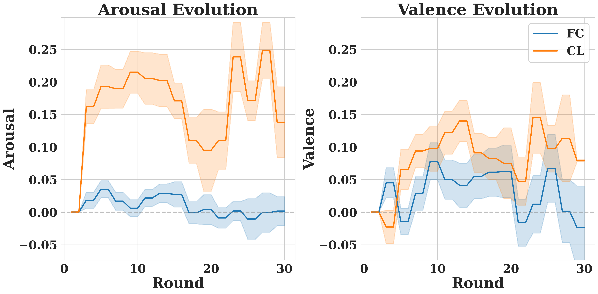
</p>

- **Signal Coupling (Paper Fig. 6e-g)**: The CL condition showed a positive arousal-valence correlation ($r=0.45$), consistent with cooperative task dynamics, whereas the baseline FaceChannel model showed a negative correlation ($r=-0.15$). The mean of individual within-subject correlations also showed a positive shift (FC: $r=-0.27$ vs. CL: $r=0.88$). A paired-sample Fisher-z test confirmed this difference was significant ($t(65)=7.73$, $p<0.001$, $d_z=0.95$).

<p align="center">
  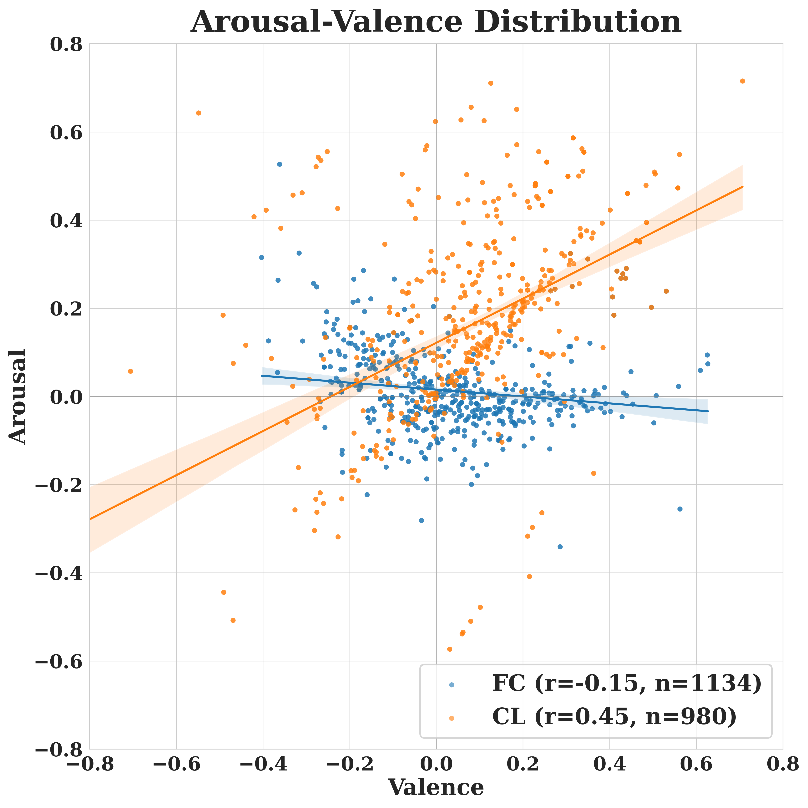
  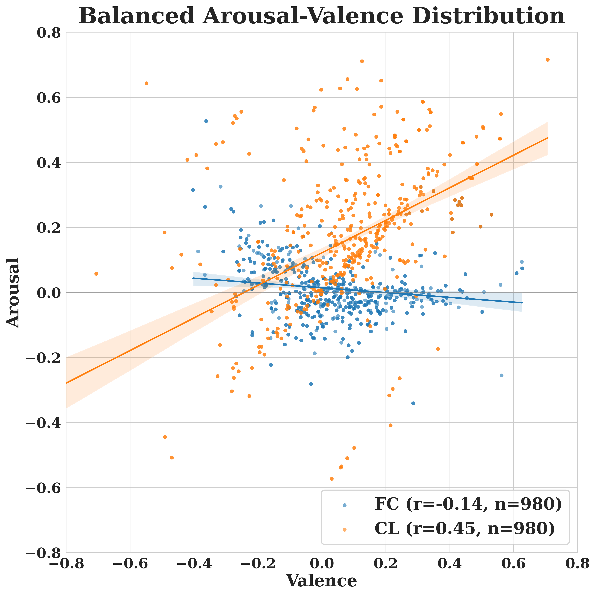
</p>
<p align="center">
  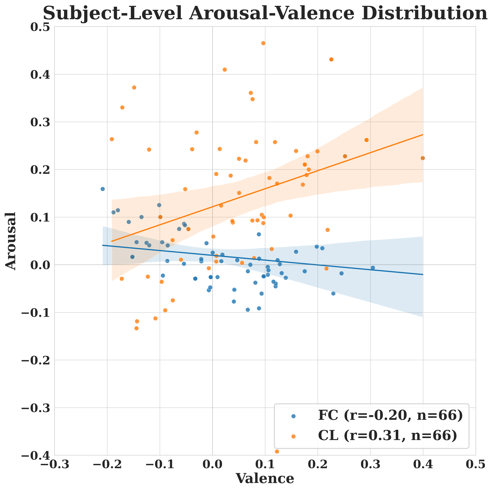
</p>

### 7.2. Behavioral Influence (RQ2)

<p align="center">
  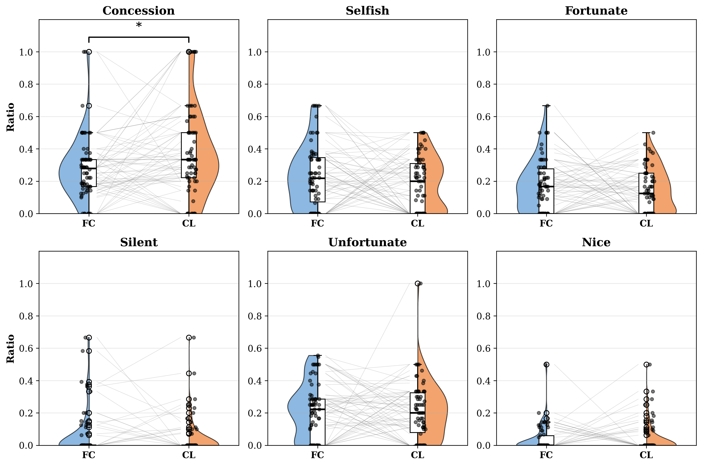
</p>

<div align="center">

| Move Type | FC | CL | *t* | *p* | *d* |
|-----------|----|----|-----|-----|-----|
| **Concession** | 0.28 ± 0.20 | **0.37 ± 0.27** | 2.55 | **0.013** | 0.32 |
| Nice | 0.04 ± 0.08 | 0.04 ± 0.09 | 0.23 | 0.82 | 0.03 |
| Fortunate | 0.18 ± 0.16 | 0.15 ± 0.14 | -1.11 | 0.27 | -0.14 |
| Unfortunate | 0.21 ± 0.17 | 0.21 ± 0.18 | -0.25 | 0.80 | -0.03 |
| Selfish | 0.23 ± 0.19 | 0.19 ± 0.17 | -1.38 | 0.17 | -0.17 |
| Silent | 0.06 ± 0.14 | 0.04 ± 0.11 | -0.87 | 0.39 | -0.11 |

</div>

- **Concession Rate**: Participants exhibited a significantly higher concession rate, **increasing from 28.0% to 37.3%** (a relative increase of 33.3%) with the CL agent (p=0.013, d=0.32).
- **Move × Condition Interaction**: CL achieves higher arousal across *all* move types, with largest effects for Concession (d=1.05) and Selfish (d=1.10).

### 7.3. Negotiation Outcomes (RQ3)

<p align="center">
  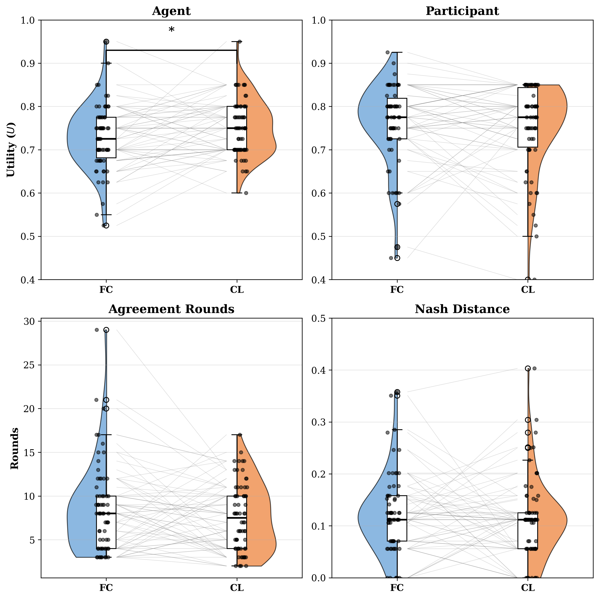
</p>

<div align="center">

| Metric | FC (Mean±SD) | CL (Mean±SD) | *t* | *p* | *d* |
|--------|--------------|--------------|-----|-----|-----|
| **Agent Utility** | 0.73 ± 0.08 | **0.75 ± 0.06** | 2.46 | **0.017** | 0.31 |
| Participant Utility | 0.76 ± 0.09 | 0.75 ± 0.10 | -0.69 | 0.49 | -0.09 |
| Nash Distance | 0.12 ± 0.08 | 0.11 ± 0.08 | -0.89 | 0.378 | -0.11 |
| Agreement Rounds | 8.56 ± 5.02 | 7.61 ± 3.83 | -1.52 | 0.13 | -0.19 |

</div>

- **Agent Utility**: **CL (0.75) > FC (0.73)**, p=0.017, d=0.31. (Significant)
- **Fairness**: Participant Utility and Nash Distance showed no significant decline, proving the agent did not exploit the human.

### 7.4. Negotiation Efficiency (RQ4)

- **Efficiency**: CL shows 11% faster trend (7.6 vs 8.6 rounds), but did not reach significance (p=0.13, d=-0.19).
- **Nash Distance**: Comparable (FC: 0.12, CL: 0.11, p=0.378), confirming agent gains did not come at the expense of the joint outcome.

### 7.5. Subjective Perception (RQ5)

<p align="center">
  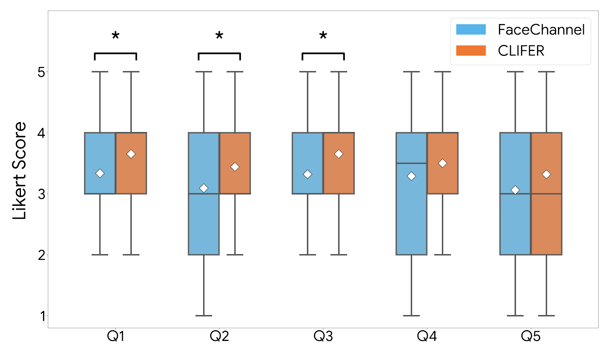
</p>

<div align="center">

| Question | *p* | *d* |
|----------|-----|-----|
| **Q1 (Preference Modeling)**: Solver modelled my preferences accurately | **0.013** | 0.32 |
| **Q2 (Affective Awareness)**: Solver considered my emotional state | **0.015** | 0.30 |
| **Q3 (Persuasiveness)**: Solver was convincing during the negotiation | **0.043** | 0.26 |
| Q4 (Participant Decisions): Solver's gestures affected my offer behavior | 0.058 | -0.21 |
| Q5 (Time Awareness): While Solver was making its offers, it considered the time | 0.121 | -0.19 |

</div>

Participants rated the CL agent as significantly more emotionally aware and persuasive, indicating a social halo effect from personalized perception.

---

## 8. Related Repositories

This repository builds upon the following foundational work:

<div align="center">

| Component | Repository |
|-----------|------------|
| **CLIFER** (Continual Learning) | [nchuramani/CLIFER](https://github.com/nchuramani/CLIFER) |
| **Negotiator** (HATN Framework) | [berkbuzcu/HumanRobotNego](https://github.com/berkbuzcu/HumanRobotNego) |
| **FaceChannel** | [pablovin/FaceChannel](https://github.com/pablovin/FaceChannel) |

</div>

---

## 9. Citation

```bibtex
@article{PersonalizedAffectivePerception2025,
  title   = {Personalized Affective Perception via Continual Learning in Human-Agent Negotiation},
  author  = {Anonymous},
  journal = {Under Review},
  year    = {2025}
}
```

---

## 10. License

This project is licensed under the MIT License - see the [LICENSE](LICENSE) file for details.
